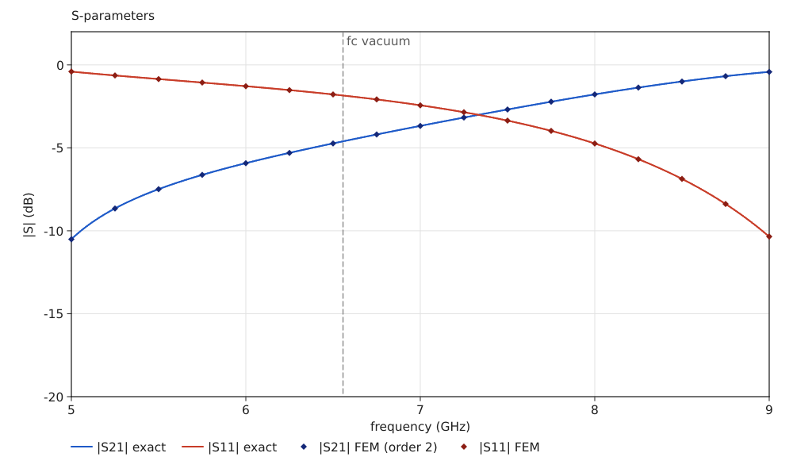
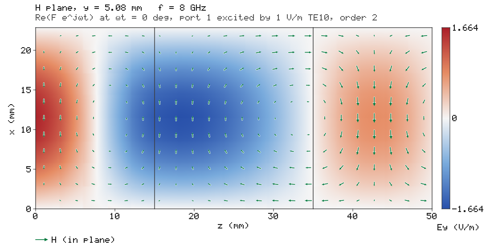
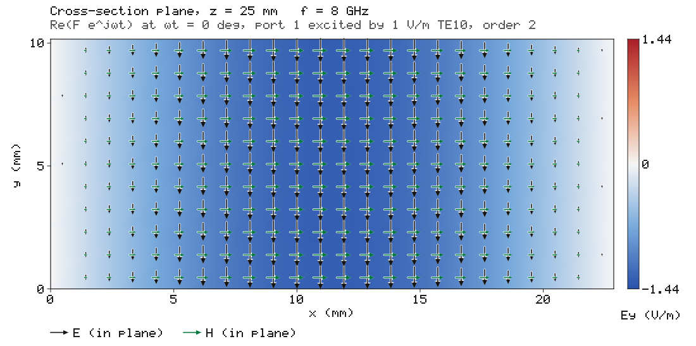
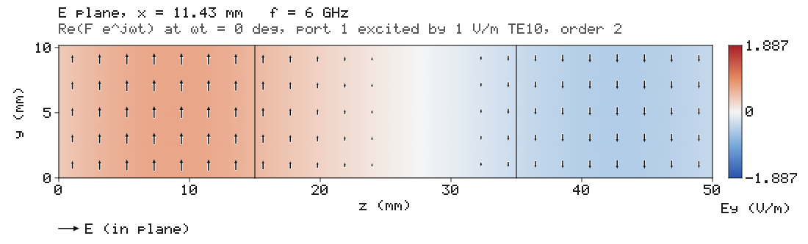
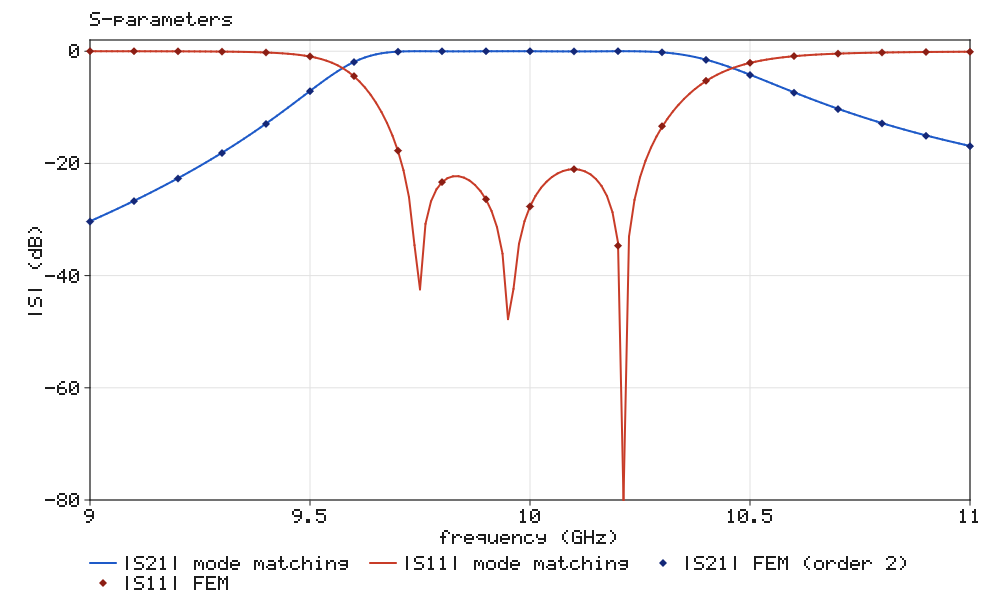
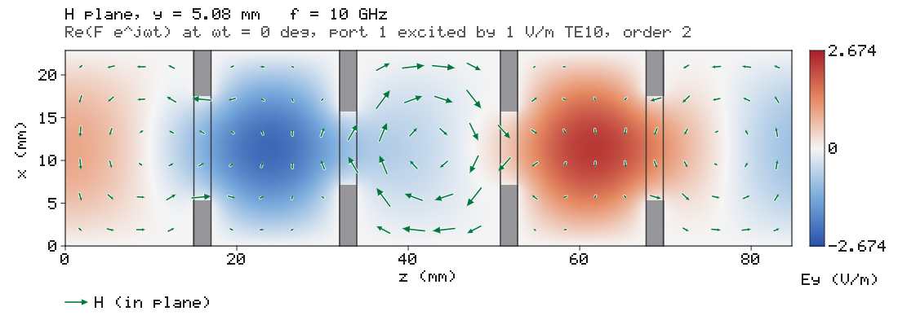

# EMCraft

An open-source electromagnetic field simulator in pure Rust: a frequency-domain finite element
solver on Nédélec edge elements, waveguide ports, S-parameters and field pictures, every
capability verified against exact solutions.

The first milestone solves rectangular-waveguide components: a waveguide **high-pass filter**
(dielectric-filled feeds around an empty section that is cut off below 6.557 GHz) matches its
closed-form solution to 10⁻³ in the complex S-parameters and 1 % in the fields, with the
convergence rates the elements promise.

```
cargo run --release -p emcraft-cli -- sample highpass --out pictures
```

```
  f (GHz)    |S21| dB      exact    |S11| dB      exact    err S21   err S11
    5.000    -10.5104   -10.5105     -0.4044    -0.4044    3.48e-5   1.11e-4
    6.000     -5.9226    -5.9229     -1.2826    -1.2824    1.11e-4   1.87e-4
    7.000     -3.6756    -3.6758     -2.4335    -2.4334    2.45e-4   2.82e-4
    8.000     -1.7783    -1.7783     -4.7366    -4.7367    5.35e-4   3.81e-4
    9.000     -0.4202    -0.4200    -10.3520   -10.3541    1.02e-3   3.34e-4
```

and writes the S-parameter chart and the E and H fields on the H-plane, the E-plane and the
cross-section:






Steps and irises (sections with a narrower aperture) are verified against mode matching; the
`iris-bandpass` sample is a three-cavity inductive-iris band-pass filter (9.75–10.25 GHz):

```
cargo run --release -p emcraft-cli -- sample iris-bandpass --out pictures
```




The desktop app shows the same, with a phase animation:

```
cargo run --release -p emcraft -- --sample highpass      # or iris-bandpass
```

## What is inside

| Crate | Role |
|---|---|
| `emcraft-model` | SI model: materials, waveguide geometry, ports, tetrahedral mesh, display units |
| `emcraft-mesh` | Structured tetrahedral meshes (Kuhn split) with apertures and edge grading, edge and face numbering, point location |
| `emcraft-fem` | Nédélec elements of orders 1 and 2 with exact element matrices; quadrature; waveguide modes |
| `emcraft-theory` | Closed-form TE10 S-parameters and fields; mode matching for H-plane steps and irises |
| `emcraft-solver` | Driven analysis with modal ports; multifrontal complex symmetric LDLᵀ |
| `emcraft-render` | CPU pictures: field plots with vector arrows, charts, PNG |
| `emcraft-engine` | Commands, sessions with rollback, scripts, samples |
| `emcraft-ui-egui` | The desktop UI |
| `emcraft-testkit` | The verification oracle |

See [docs/architecture.md](docs/architecture.md), [docs/verification.md](docs/verification.md)
and the results in [docs/oracle.md](docs/oracle.md).

## Licence

MIT OR Apache-2.0.
