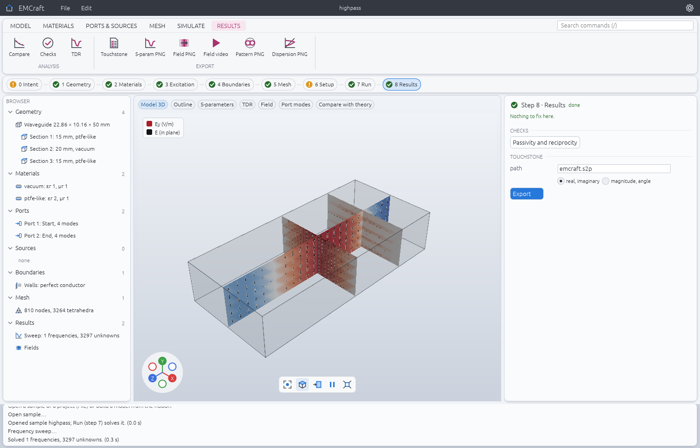
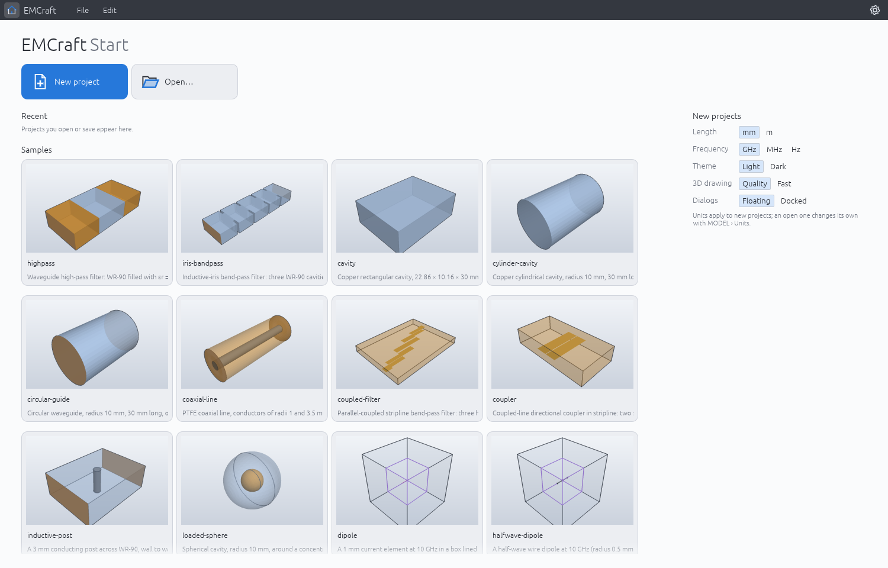

# EMCraft

An open-source electromagnetic field simulator in pure Rust for microwave and RF components:
finite element and time-domain solvers, S-parameters, fields and far fields, every capability
checked against exact solutions or published benchmarks.



## Quick start

```
cargo run --release -p emcraft -- --sample highpass                 # the desktop app
cargo run --release -p emcraft-cli -- sample highpass --out pictures  # S-parameters against the exact solution, field pictures
cargo run --release -p emcraft-cli -- commands                      # every command and its parameters
```

Samples: `highpass`, `iris-bandpass`, `cavity`, `cylinder-cavity`, `circular-guide`,
`coaxial-line`, `coupled-filter`, `coupler`, `inductive-post`, `loaded-sphere`, `dipole`,
`halfwave-dipole`, `open-waveguide`, `sphere-scattering`.

## What it does

- **Geometry:** rectangular waveguides with steps and irises, planar circuits (strips, vias,
  layers), boxes, cylinders, spheres and their Boolean combinations, STL and 3MF import with
  exact surfaces fitted to the faces.
- **Frequency domain:** Nédélec elements of orders 1 and 2 (curved on curved walls), modal,
  terminal, lumped and Floquet ports, a fast frequency sweep, adaptive mesh refinement.
- **Eigenmodes:** cavity resonances with Q factors, port modes of any cross-section,
  dispersion diagrams of periodic cells.
- **Materials:** dielectric and magnetic losses, Debye, Lorentz and Drude dispersion, walls of
  finite conductivity, ports on lossy substrates.
- **Radiation:** perfectly matched layers, dipoles, lumped feeds and plane waves, far fields,
  directivity and radar cross-section.
- **Time domain:** finite integration on hexahedral grids with losses and dispersion, on CPU
  threads or GPUs.
- **Studies:** variables, parameter sweeps on a grid and optimization.
- **Everything is a command:** the app, scripts (`emcraft-cli run script.json`) and agents
  (a JSON control channel, [docs/control-protocol.md](docs/control-protocol.md)) reach the same
  commands ([docs/features.md](docs/features.md)).

Large problems: the direct solver writes the part of its factor that does not fit in memory to
disk (`EMCRAFT_FACTOR_MEMORY_GB`, `EMCRAFT_SCRATCH`).

## Verified

Each solver capability is compared with a closed form, mode matching or a published benchmark,
and the accepted results are frozen so that any change that moves them fails CI
([docs/verification.md](docs/verification.md), results in [docs/oracle.md](docs/oracle.md)).

| | |
|---|---|
|  |  |
| High-pass filter: exact, FEM and time domain | Dielectric sphere's RCS against the Mie series |
|  |  |
| Iris band-pass filter at 10 GHz | Copper cavity's TE101 mode, Q = 7614 |



## More

[docs/architecture.md](docs/architecture.md) (crates and layers),
[docs/solvers/literature.md](docs/solvers/literature.md) (the papers behind each method),
[docs/themes.md](docs/themes.md) (themes: the colours of the app and its pictures, your own as files),
[docs/languages.md](docs/languages.md) (the window in English or Japanese, and how to translate it),
[ROADMAP.md](ROADMAP.md), [AGENTS.md](AGENTS.md) (how to contribute, for people and agents).

## Licence

MIT OR Apache-2.0.
