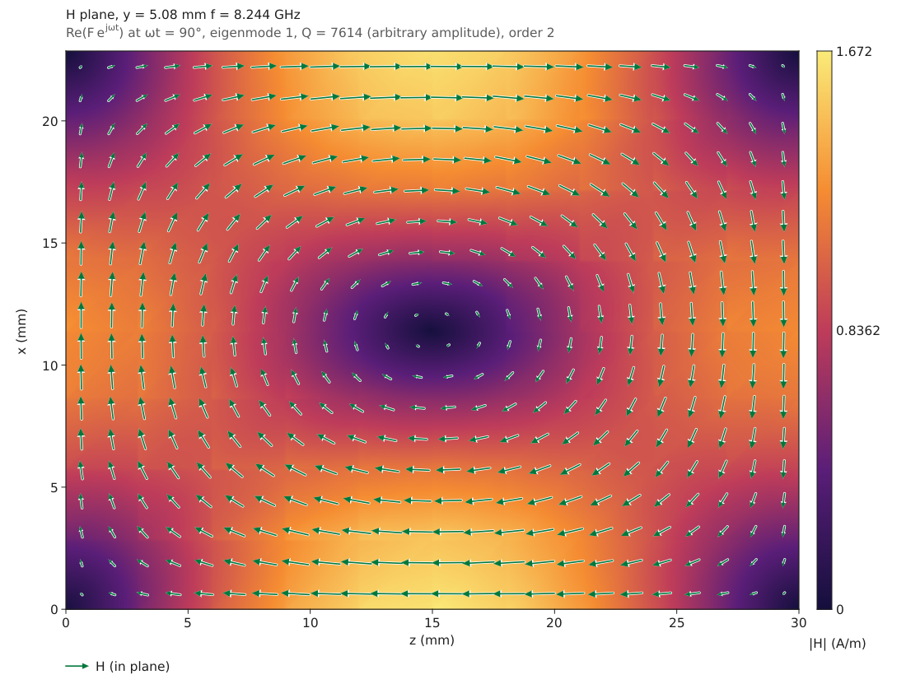
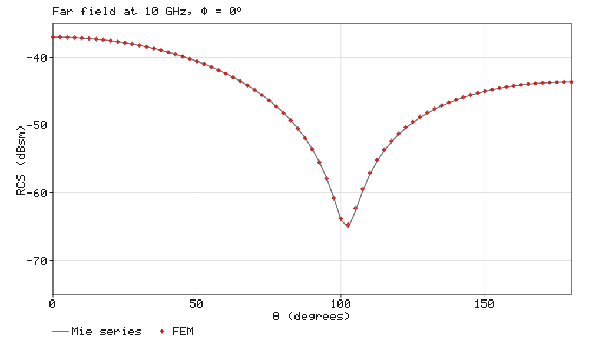
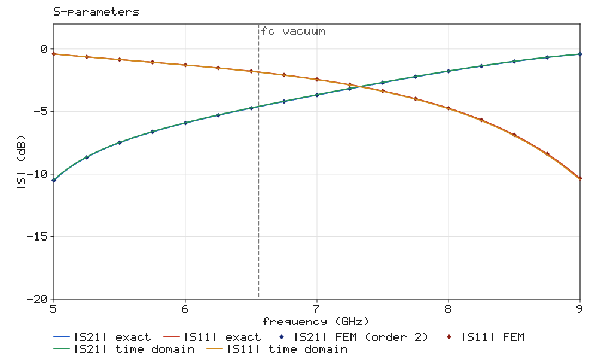

# EMCraft

An open-source electromagnetic field simulator in pure Rust: a frequency-domain finite element
solver on Nédélec edge elements, waveguide ports, S-parameters and field pictures, every
capability verified against exact solutions.

The first milestone solves rectangular-waveguide components: a waveguide **high-pass filter**
(dielectric-filled feeds around an empty section that is cut off below 6.557 GHz) matches its
closed-form solution to 10⁻³ in the complex S-parameters and 1 % in the fields, with the
convergence rates the elements promise.

```
cargo run --release -p emcraft-cli -- sample highpass --out pictures
```

```
  f (GHz)    |S21| dB      exact    |S11| dB      exact    err S21   err S11
    5.000    -10.5104   -10.5105     -0.4044    -0.4044    3.48e-5   1.11e-4
    6.000     -5.9226    -5.9229     -1.2826    -1.2824    1.11e-4   1.87e-4
    7.000     -3.6756    -3.6758     -2.4335    -2.4334    2.45e-4   2.82e-4
    8.000     -1.7783    -1.7783     -4.7366    -4.7367    5.35e-4   3.81e-4
    9.000     -0.4202    -0.4200    -10.3520   -10.3541    1.02e-3   3.34e-4
```

and writes the S-parameter chart and the E and H fields on the H-plane, the E-plane and the
cross-section:


Steps and irises (sections with a narrower aperture, in the H-plane or the E-plane) are verified
against mode matching; the
`iris-bandpass` sample is a three-cavity inductive-iris band-pass filter (9.75–10.25 GHz):

```
cargo run --release -p emcraft-cli -- sample iris-bandpass --out pictures
```


Cavities have an eigenmode solver with Q factors from wall and dielectric losses:

```
cargo run --release -p emcraft-cli -- sample cavity --out pictures
```

```
 mode       f (GHz)        exact    exact          Q
    1      8.244032     8.243877    TE101     7614.0
    2     11.953276    11.952313    TE102     9411.6
    3     14.035151    14.033880    TE201     9411.8
    4     15.577196    15.576685    TE011     7888.7
```



Bodies other than waveguides — boxes, cylinders, spheres, Boolean combinations of them
(`geometry.feature`: a post through a guide, a stub on it) and closed surfaces imported from STL
or 3MF (`geometry.import`; a part drawn as its metal gives the air it encloses, `region:
cavity`) — are meshed with unstructured tetrahedra (a mesher ported from
FieldCraft), with dielectric or conducting inclusions as regions of their own, the tetrahedra on
curved walls curved, and the element size set per material from the wavelength if asked. A
cylindrical cavity's resonances meet the Bessel zeros to 4e-5 (`sample cylinder-cavity`), and
circular-waveguide ports carry the TE and TM Bessel modes (`sample circular-guide`).

Open problems: a box lined with a perfectly matched layer (`model.open`), driven by a dipole
(`source.dipole`) or lit by a plane wave (`source.plane_wave`), with far fields from a
near-to-far transform. A ceramic sphere's radar cross-section meets the Mie series:



Losses: dielectrics with a loss tangent and walls of finite conductivity (surface impedance),
checked against the exact lossy cascade and the textbook conductor attenuation; ports on lossy
substrates (a microstrip or stripline on FR-4) take hybrid lossy modes with their complex γ.

A time-domain solver (finite integration on a hexahedral grid, like CST's) cross-checks the
FEM: `solve.time_domain` puts its curves on the same chart. It takes dispersive and lossy
materials (loss tangents as conductivities matched at the band's centre), magnetic losses,
walls of finite conductivity (the surface impedance as branches of surface current) and lossy
or dispersive ports.



The desktop app shows the same, with a phase animation; besides its waveguide editor it runs
any sample or command script (solids, imported surfaces, open problems with their far-field
pattern):

```
cargo run --release -p emcraft -- --sample highpass      # or iris-bandpass, cavity, or any
                                                         # engine sample: sphere-scattering, …
```

Large problems: the direct solver keeps its factor in memory up to a quarter of what the system has
available (`EMCRAFT_FACTOR_MEMORY_GB` to set it) and writes the rest to a scratch file on disk
(`EMCRAFT_SCRATCH`, default `~/.cache/emcraft`), so the problem size is bounded by the disk
rather than the memory.

## What is inside

| Crate | Role |
|---|---|
| `emcraft-model` | SI model: materials, waveguide geometry, solids, inclusions, features, ports, open boundaries and sources, tetrahedral mesh, display units |
| `emcraft-tetmesh` | The unstructured tetrahedral mesher (exact predicates, constrained Delaunay, refinement), ported from FieldCraft |
| `emcraft-mesh` | Structured tetrahedral meshes (Kuhn split) with apertures and edge grading; unstructured meshes of solids with regions, Boolean features and curved edges; edge and face numbering, point location |
| `emcraft-io` | STL and 3MF import |
| `emcraft-fem` | Nédélec elements of orders 1 and 2, straight (exact matrices) or curved (quadrature); quadrature; Bessel functions; rectangular and circular waveguide modes |
| `emcraft-theory` | Closed forms: TE10 S-parameters and fields, cavity resonances, mode matching for steps and irises, the Hertzian dipole and the Mie series |
| `emcraft-solver` | Driven analysis with modal ports, losses, cavity eigenmodes, open problems with a PML and far fields; multifrontal complex symmetric LDLᵀ |
| `emcraft-fdtd` | Time domain: finite integration with PML-terminated waveguide ports |
| `emcraft-render` | CPU pictures: field plots with vector arrows, charts, PNG |
| `emcraft-engine` | Commands, sessions with rollback, scripts, samples |
| `emcraft-ui-egui` | The desktop UI |
| `emcraft-testkit` | The verification oracle |

See [docs/architecture.md](docs/architecture.md), [docs/verification.md](docs/verification.md)
and the results in [docs/oracle.md](docs/oracle.md).

## Licence

MIT OR Apache-2.0.
