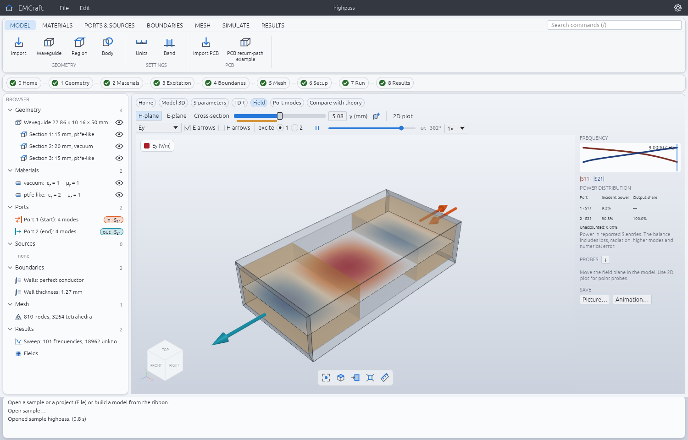
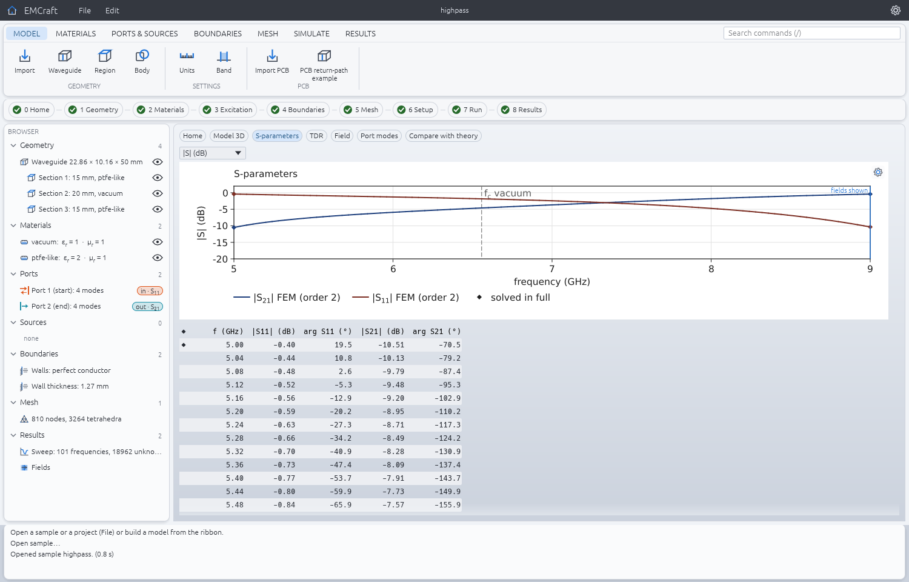
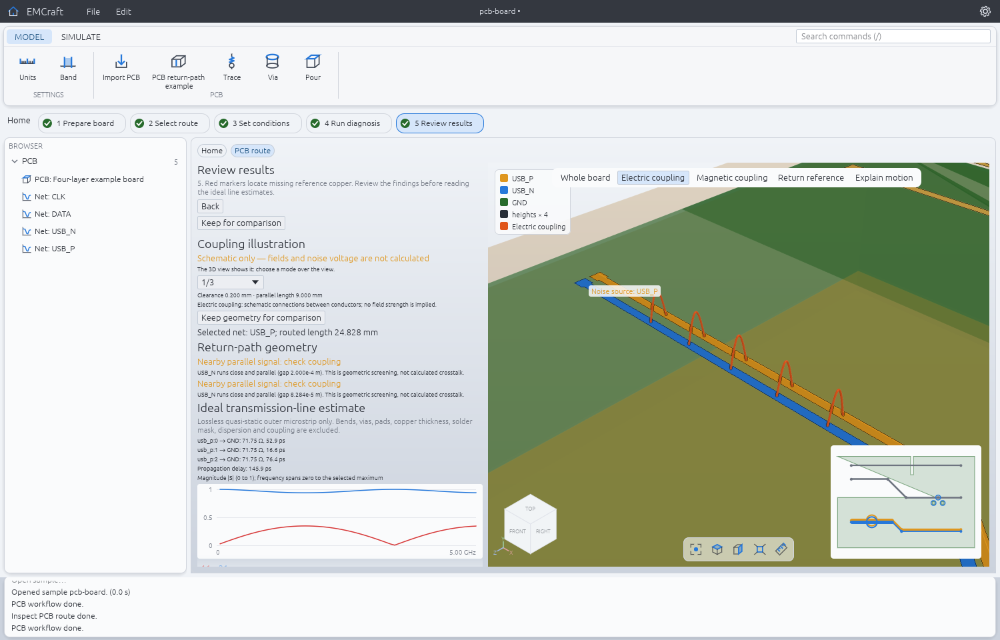
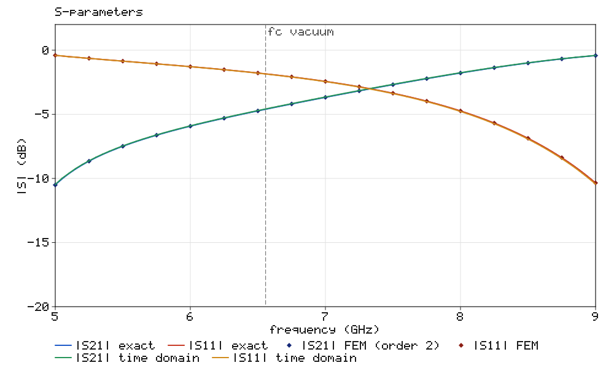
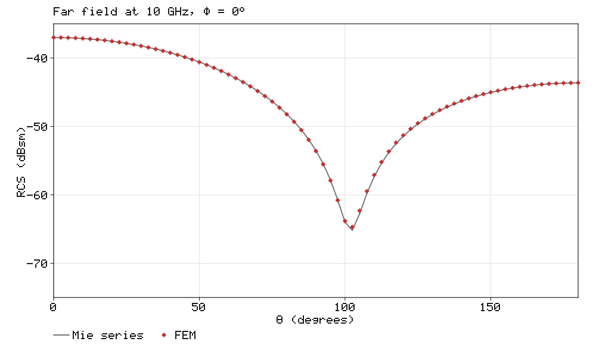
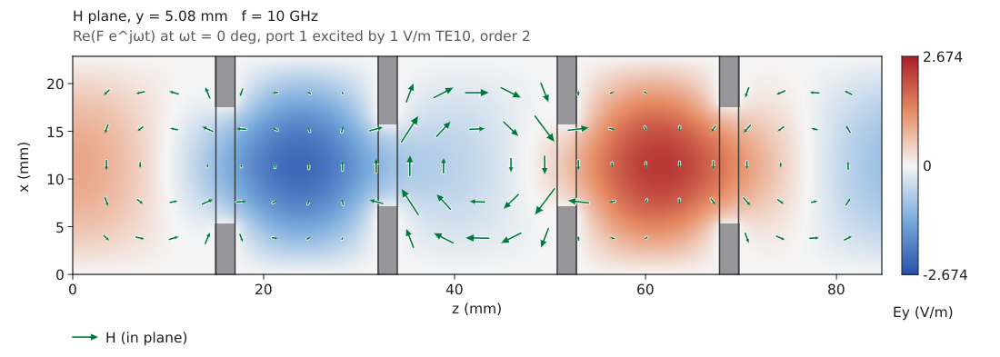
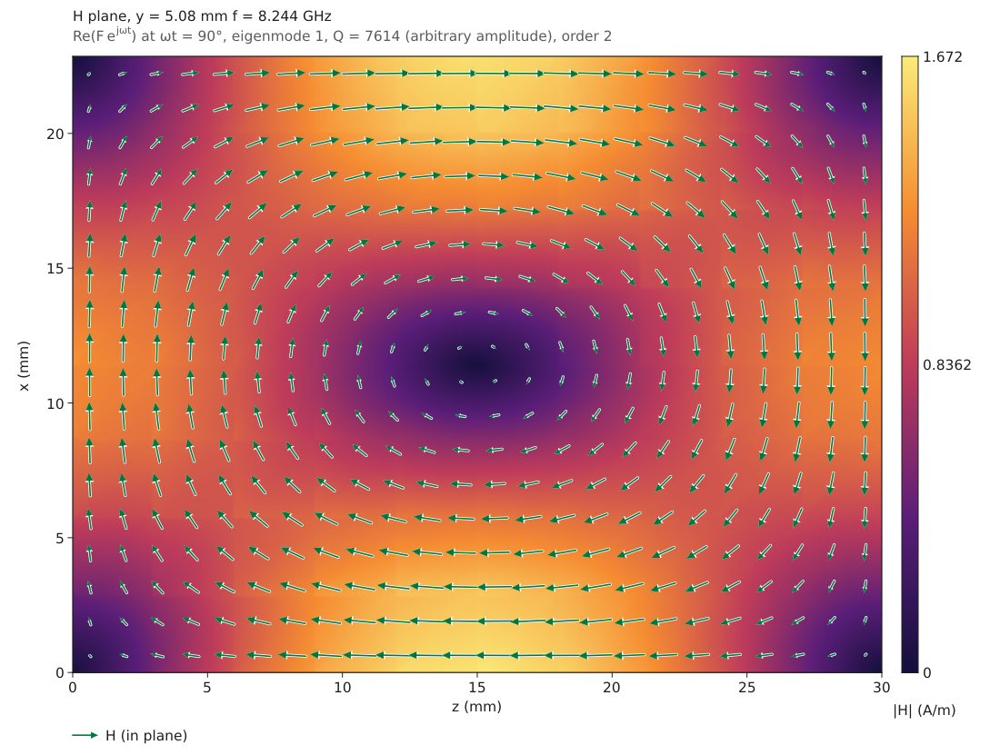
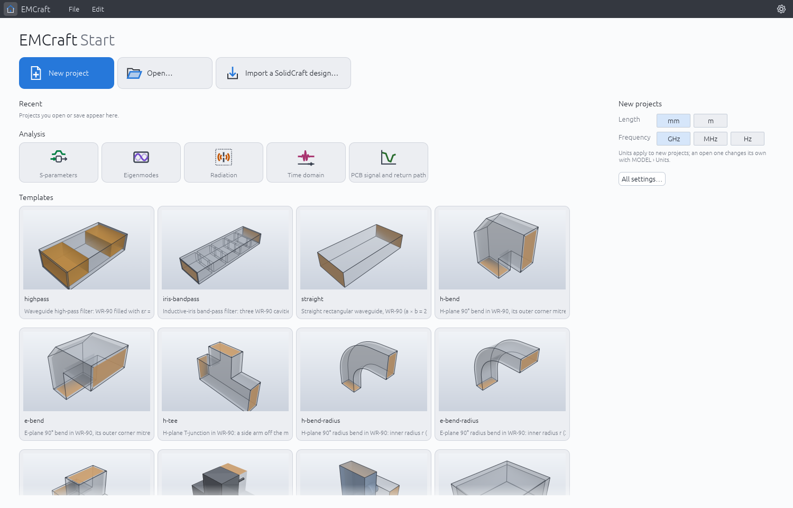

# EMCraft

An open-source electromagnetic field simulator in pure Rust for microwave, RF and PCB work:
finite element and time-domain solvers, S-parameters, fields and far fields, every capability
checked against exact solutions or published benchmarks.



## Quick start

```
cargo run --release -p emcraft -- --sample highpass                 # the desktop app
cargo run --release -p emcraft-cli -- sample highpass --out pictures  # S-parameters against the exact solution, field pictures
cargo run --release -p emcraft-cli -- commands                      # every command and its parameters
```

On Windows, use the installer: [docs/install-windows.md](docs/install-windows.md).

Samples (the start page's templates, their dimensions variables):

- **Waveguides:** `highpass`, `iris-bandpass`, `straight`, `taper`, `termination`, bends and
  tees (`h-bend`, `e-bend`, `h-bend-radius`, `e-bend-radius`, `h-tee`, `e-tee`, `magic-tee`),
  `cross-guide-coupler`, `coupled-filter`, `coupler`, `inductive-post`, `circular-guide`,
  `coaxial-line`.
- **Microstrip circuits:** `pcb-stub-filter`, `pcb-lowpass`, `pcb-quarter-wave`,
  `pcb-branch-line`, `pcb-coupled-line`, `pcb-bend`, `pcb-wilkinson` (its isolating resistor a lumped
  element), `pcb-ring`.
- **Resonators:** `cavity`, `cylinder-cavity`, `sphere-cavity`, `coaxial-cavity`, `slab-cavity`,
  `loaded-sphere`, `dielectric-resonator`, `combline-resonator`, `reentrant-cavity`.
- **Dispersion diagrams:** `dispersion-guide`, `dispersion-loaded`, `dispersion-iris`,
  `dispersion-corrugated`.
- **Antennas and scattering:** `dipole`, `halfwave-dipole`, `yagi`, `monopole`, `patch-antenna`,
  `open-waveguide`, `horn`, `sphere-scattering`, `metal-sphere-scattering`.
- **Time domain:** `td-dielectric-slab`, `td-quarter-wave`, `td-lossy-slab`,
  `td-dispersive-slab`, `td-eplane-step`, `td-wall-loss`; on solids `td-h-bend`, `td-e-bend`,
  `td-h-bend-radius`, `td-e-bend-radius`, `td-inductive-post`, `td-termination`, `td-h-tee`,
  `td-e-tee`, `td-magic-tee`, `td-cross-guide-coupler`; the antenna `td-dipole`; plane waves on
  `td-sphere-scattering` and `td-metal-sphere-scattering`.
- **Boards:** `pcb-microstrip`, `pcb-split-ground`, `pcb-parallel`, `pcb-board` (four layers).

## What it does

- **Geometry:** rectangular waveguides with steps and irises, boxes, cylinders, spheres and
  their Boolean combinations, STL, 3MF and SolidCraft designs with exact surfaces fitted to the
  faces, symmetry planes.
- **Boards:** KiCad boards read whole (tracks, arcs, vias, pads, pours, the stackup) or drawn
  and edited in 3D; route screening (return-path gaps, reference edges, nearby signals); a
  layered prism mesher for the finite elements, lumped ports at trace ends.
- **Frequency domain:** Nédélec elements of orders 1 and 2 (curved on curved walls), modal,
  terminal, lumped and Floquet ports, a fast frequency sweep, adaptive mesh refinement; a
  multifrontal direct solver (out of core past memory) and GMRES with p-multigrid for large
  second-order systems.
- **Eigenmodes:** cavity resonances with Q factors, port modes of any cross-section,
  dispersion diagrams of periodic cells.
- **Materials:** dielectric and magnetic losses, Debye, Lorentz and Drude dispersion, walls of
  finite conductivity, ports on lossy substrates.
- **Radiation:** perfectly matched layers, dipoles, lumped feeds and plane waves, far fields,
  directivity and radar cross-section.
- **Time domain:** finite integration on hexahedral grids with losses and dispersion, on CPU
  threads or GPUs; TDR from any sweep.
- **Studies:** variables, parameter sweeps on a grid (with a surrogate) and optimization.
- **Projects:** one `.emcraft` file holds the model's history, its mesh and its results — the
  fields too — so a project opens without solving again; every solve is kept with how it was
  made (time, unknowns, device) for comparison ([docs/project-file.md](docs/project-file.md)).
- **Everything is a command:** the app, scripts (`emcraft-cli run script.json`) and agents
  (a JSON control channel, [docs/control-protocol.md](docs/control-protocol.md)) reach the same
  commands ([docs/features.md](docs/features.md)). The window speaks English and Japanese.

| | |
|---|---|
|  |  |
| S-parameters of the high-pass filter | The four-layer example board, its pair's coupling |

## Verified

Each solver capability is compared with a closed form, mode matching or a published benchmark,
and the accepted results are frozen so that any change that moves them fails CI
([docs/verification.md](docs/verification.md), results in [docs/oracle.md](docs/oracle.md)).

| | |
|---|---|
|  |  |
| High-pass filter: exact, FEM and time domain | Dielectric sphere's RCS against the Mie series |
|  |  |
| Iris band-pass filter at 10 GHz | Copper cavity's TE101 mode, Q = 7614 |



## More

[docs/architecture.md](docs/architecture.md) (crates and layers),
[docs/solvers/literature.md](docs/solvers/literature.md) (the papers behind each method),
[docs/pcb.md](docs/pcb.md) (boards: import, screening and the finite elements),
[docs/project-file.md](docs/project-file.md) (the `.emcraft` file),
[docs/themes.md](docs/themes.md) (themes: the colours of the app and its pictures, your own as files),
[docs/languages.md](docs/languages.md) (the window in English or Japanese, and how to translate it),
[ROADMAP.md](ROADMAP.md), [AGENTS.md](AGENTS.md) (how to contribute, for people and agents).

## Licence

MIT OR Apache-2.0.
